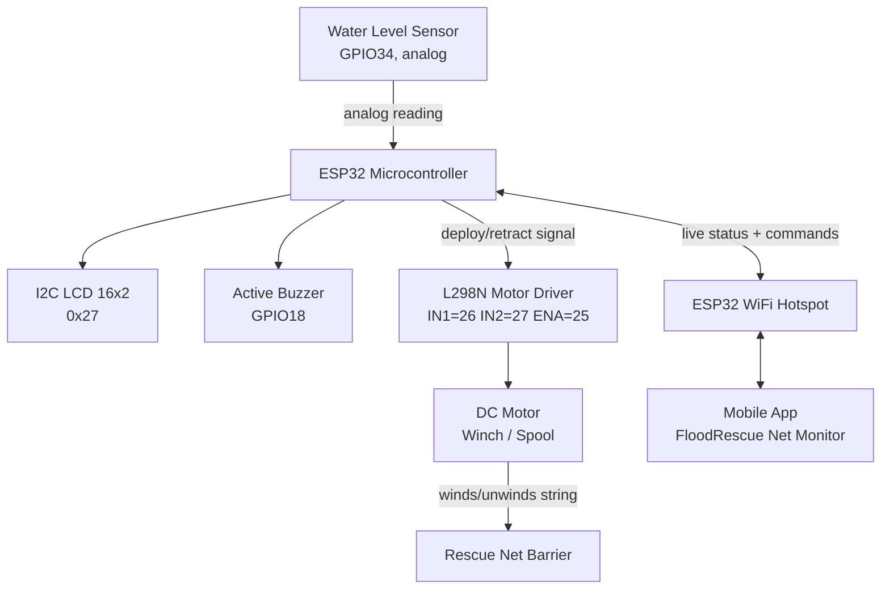
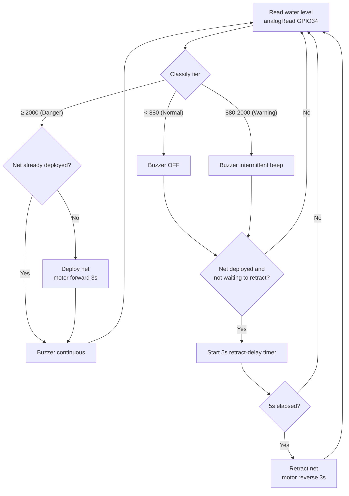
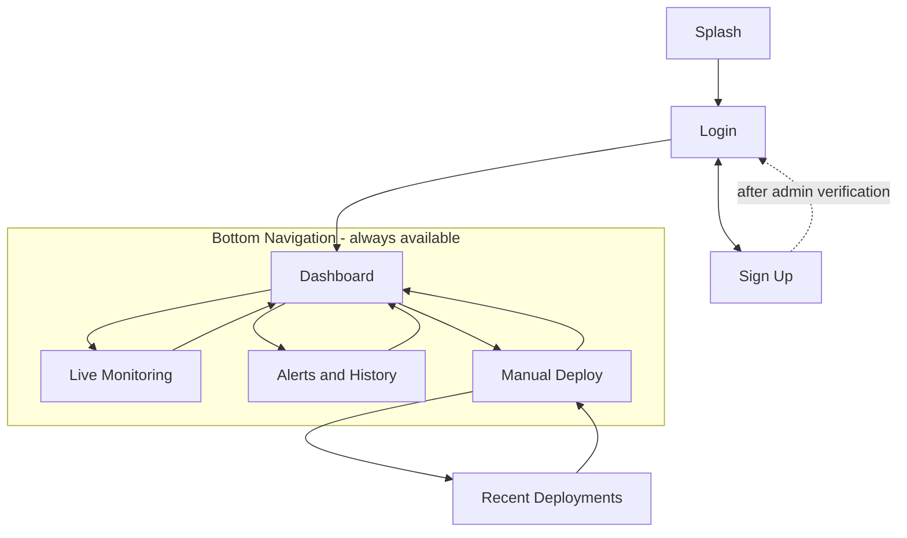
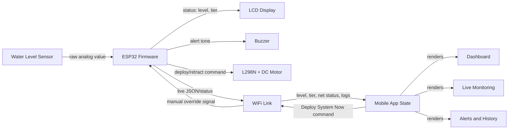

# FloodRescue Net Monitor — Function Inventory

## Prelim Completion Status (System Programmer — 25% target)

**As of 2026-07-29: 0 of 17 top-level functions have real working logic.** All 8 mobile screens exist and are navigable (`C:\D\FloodRescueNetMonitor`), but every one currently runs on `SampleData.java` static mock data — e.g. `LoginActivity.java` just navigates to Dashboard on tap, with no actual credential check. UI scaffold ≠ working function; only real, verifiable logic counts toward this milestone.

**Backend decided (2026-07-29): Firebase Realtime Database.** ESP32 will push sensor readings/status to Firebase RTDB; the app reads/writes there instead of talking to the ESP32 directly over local WiFi. This decouples app development from the physical hardware being connected — Live Monitoring, Dashboard, and Alerts can all be built and tested now by manually pushing test values into the Firebase console, without the ESP32 working yet. Login/Sign Up can use Firebase Authentication instead of a local-only store.

**Realistic near-term target — no longer strictly hardware-independent, now "Firebase-first" instead:**
- [x] Login credential validation via Firebase Authentication (email/password) — implemented in `LoginActivity.java` (2026-07-29): validates input, calls `signInWithEmailAndPassword`, shows real error messages on failure, auto-skips to Dashboard if already signed in.
- [x] Sign Up via Firebase Authentication + save profile (Barangay/Office, Role) to Firebase RTDB — implemented in `SignUpActivity.java` (2026-07-29): validates all required fields + password match/length, calls `createUserWithEmailAndPassword`, writes profile (fullName, barangay, role, email, verified:false, createdAt) to `users/{uid}` in RTDB.
- [x] "Forgot Password?" flow via Firebase's built-in password reset — implemented in `LoginActivity.java` (2026-07-29): "Forgot Password?" text now has an id and calls `sendPasswordResetEmail`.
- [ ] Dashboard/Live Monitoring reading from Firebase RTDB (can be tested today with manually-entered test values in the Firebase console, before the ESP32 is writing to it) — not yet implemented, still on `SampleData.java`.

**⚠️ Setup still required before this actually runs (cannot be done by Claude — needs your Google account):**
1. Go to the Firebase console (console.firebase.google.com) and create a project.
2. Add an Android app to it with package name `com.example.floodrescuenetmonitor`.
3. Enable **Authentication → Sign-in method → Email/Password**.
4. Create a **Realtime Database** (start in test mode for now, lock down rules before going live).
5. Download the generated `google-services.json` and place it at `C:\D\FloodRescueNetMonitor\app\google-services.json` (this file does not exist yet and the build will fail without it).
6. Sync/build the project in Android Studio.

Manual Deploy (writing a command back to Firebase for the ESP32 to pick up) and Section B (hardware/firmware pushing real sensor data into Firebase) still depend on the physical build being connected — not counted toward this milestone yet. That's expected at this stage of the term, not a shortfall.

Source: `visily-multiscreens.pdf` (8 screens) + `KNOWLEDGE.md` (ESP32 prototype logic).
Two parts: **A. Mobile App (UI) functions** and **B. Prototype (hardware/firmware) functions**.

---

## A. Mobile App Functions (by screen)

### 1. Splash Screen
- Displays app identity ("FloodRescue Net Monitor") and system label ("DRRM SYSTEM v1.0.4 — Official Use Only")
- Auto-connects to the ESP32 node over WiFi ("Connecting to node...")
- Initializes sensor link and shows loading/estimated-time feedback ("Initializing sensors... Estimated time: 2-3s")

### 2. Login (Authentication)
- Accepts username/email + password input
- Validates barangay-official credentials against stored accounts
- "Forgot Password?" recovery entry point
- Displays official-use security notice (logs unauthorized access attempts)
- Routes to Sign Up for new/unregistered officials

### 3. Sign Up (Create an Account)
- Collects: Full Name, Barangay/Office, Role/Position (optional), Email, Password, Confirm Password
- Required-field validation (marked with *)
- Submits account for manual DRRM-admin verification before granting access
- Routes back to Login for existing accounts

### 4. Dashboard (Home)
- Shows current water level reading (cm) with Normal/Warning/Danger tier indicator
- Displays Rescue Net Status (Ready/Deployed) as a live badge
- Live Monitoring mini-widget: current cm reading + trend sparkline
- View History mini-list: last 3 events with status chips (Resolved/Passed/Pending)
- Shows most recent system self-check result
- Emergency Contacts quick-dial list: 911, Barangay Hall, MDRRMO Office, Local Rescue Team — each tappable to call
- Bottom navigation: Home / Live / Alerts / Deploy

### 5. Live Monitoring
- Real-time water-level gauge (large numeric cm reading, live-updating)
- Trend indicator (e.g., "Rising rapidly", "Stable", "Receding") with LIVE tag
- Sensor health tiles: Signal strength, Battery %, Rain intensity
- Net Deployment physical-status card: current state (Ready/Deployed), last activity timestamp
- "System Diagnostic" trigger button (manual self-test request)
- Recent Activity feed: timestamped cm readings with trend tag, link to full data logs
- Active flood-warning banner when threshold exceeded

### 6. Alerts & History
- Filterable event feed: All / Danger / Net Deployments / System (tab filter)
- Event cards: type (Critical Water Level, Net Deployed, Rising Water Alert, System Self-Test), severity badge (Danger/Deployed/Warning/System OK), timestamp, short description
- "Details" drill-down per event
- Link out to Live Monitoring Data
- End-of-list marker ("End of historical records")

### 7. Manual Deploy
- System Vitals readout: Battery %, Network latency, Core temperature, Mechanical alignment status
- Auto-mode toggle (switch between automatic threshold-based deployment and manual control)
- Configuration inputs: Net Deployment Location, Estimated Duration, Thrust Power
- Pre-Deployment Checklist (stabilizers engaged, sensors calibrated, comms link verified, emergency shutdown active)
- "Deploy System Now" manual-trigger button (human override of automatic deployment)
- Deployment Logs preview (barangay, timestamp, initiator, result) with "View All" link

### 8. Recent Deployments (Deployment Log Detail)
- Activity Summary counters: Total / Success / Failed deployments (today)
- Detailed log entries: timestamp, location/zone, initiator (Manual vs. System), unit ID, cycle time, result (Success/Failed/Pending)
- Error diagnostics shown inline for failed deployments (e.g., "Motor Jammed — Mechanical Obstruction in Net Rail")
- Refresh control; note that older logs archive to cloud after 24 hours

---

## B. Prototype (ESP32 Hardware/Firmware) Functions

Derived from `KNOWLEDGE.md` working code:

1. **Water level sensing** — continuous `analogRead()` on GPIO34, classified into NORMAL (<880), WARNING (880–2000), DANGER (≥2000)
2. **Local status display** — I2C LCD (0x27, 16×2) shows live numeric level + status label
3. **Tiered audible alert** — active buzzer (GPIO18): silent at Normal, intermittent beep at Warning, continuous at Danger
4. **Automated net deployment** — on DANGER, L298N motor driver (IN1=26, IN2=27, ENA=25/PWM) drives the DC motor forward for 3s to deploy the net via winch/spool
5. **Automated net retraction** — once level drops back below Warning and stays there for 5s (`RETRACT_DELAY_MS`), motor reverses for 3s to retract
6. **State tracking** — `netDeployed` / `waitingToRetract` flags prevent redundant deploy/retract cycles
7. **Wireless status transmission** — ESP32 WiFi hotspot feeds live level/status/deployment state to the mobile app (Dashboard, Live Monitoring, Alerts screens)
8. **Manual override input** — mobile app's "Deploy System Now" command can trigger deployment independent of sensor threshold (Manual Deploy screen)
9. **Self-diagnostic check** — reports motor/sensor functional status (surfaces in app as "System Self-Test" events and "System Diagnostic" button)

---

## Suggested Diagrams to Include in the Thesis

1. **System Architecture Diagram** — ESP32 at center, branching to: Water Level Sensor (input), I2C LCD + Buzzer (local output), L298N + DC Motor/Winch (physical actuation output), WiFi link to Mobile App (remote output). Already sketched in `KNOWLEDGE.md`'s architecture block — turn that into a boxed figure.
2. **Flowchart — Detection-to-Deployment Logic** — Start → Read sensor → Classify tier → (Danger? → Deploy net → Buzzer continuous) / (Warning? → Beep intermittent) / (Normal? → idle) → after drop below Warning, wait 5s → Retract. This mirrors the `loop()` function in KNOWLEDGE.md.
3. **UI Navigation Flow (mobile app)** — Splash → Login ⇄ Sign Up → Dashboard → (Live Monitoring | Alerts & History | Manual Deploy → Recent Deployments), all reachable from the bottom nav bar (Home/Live/Alerts/Deploy).
4. **Data Flow Diagram** — Sensor reading → ESP32 processing → (a) local LCD/buzzer output, (b) WiFi transmission → Mobile App state → rendered on Dashboard/Live/Alerts screens; and the reverse path: Manual Deploy command → WiFi → ESP32 → Motor actuation.

### Diagram 1 — System Architecture

### Diagram 2 — Detection-to-Deployment Flowchart

### Diagram 3 — Mobile App Navigation Flow

### Diagram 4 — Data Flow Diagram

---

Each block above is standard Mermaid syntax — paste into any Mermaid renderer (VS Code Mermaid preview, mermaid.live, Notion, Obsidian) to view/export as an image, then paste that image into the Word document. Tell me if you'd like these rendered to PNG now instead.
